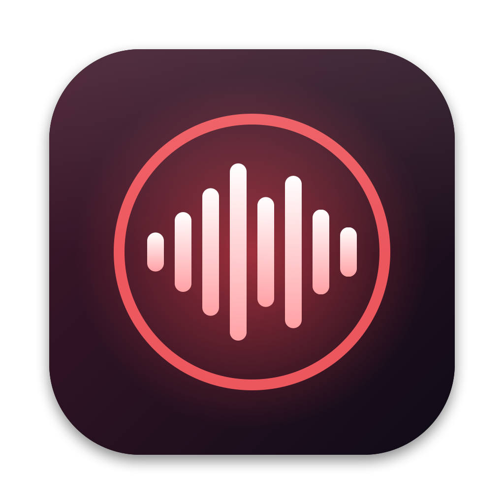
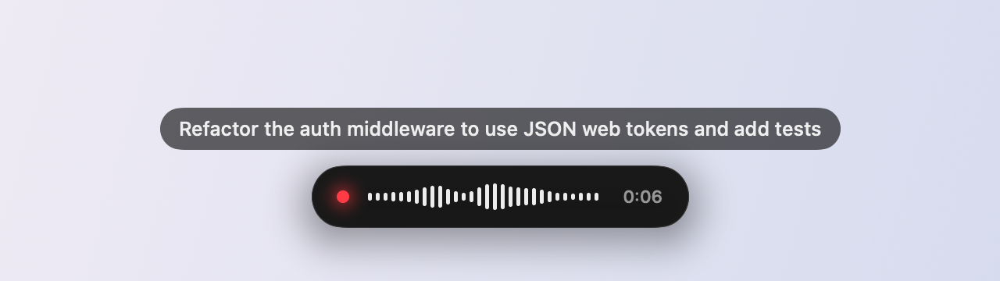

<p align="center">
  
</p>

<h1 align="center">VOIX</h1>

<p align="center">
  <b>Fast push-to-talk dictation for macOS.</b><br>
  Hold a key, speak, release. Your words are typed wherever you're working.
</p>

<p align="center">
  <a href="https://github.com/mfarivar/VOIX/releases/latest"></a>
  <a href="https://github.com/mfarivar/VOIX/actions/workflows/build.yml"></a>
  
  <a href="LICENSE"></a>
</p>

<p align="center">
  
</p>

VOIX sits in your menu bar. Hold **Right ⌥ Option** and a small recording pill slides up from the bottom of the screen, showing a live waveform and your words as you speak. Release the key and the text is pasted into the focused field, usually in well under a second. Your clipboard is restored afterwards.

I built it as a fast, lightweight way to dictate prompts to AI tools, and it works in any app where you can type.

## Features

- **Push-to-talk.** Hold a modifier key to record: Right ⌥ (default), Left ⌥, Right ⌘, Right ⌃, Right ⇧ or fn.
- **Private by default.** Apple speech recognition runs on-device whenever macOS supports it for your language (it does for English on modern Macs).
- **Local Whisper, optional.** [whisper.cpp](https://github.com/ggml-org/whisper.cpp) `base.en` or `small.en`, kept loaded in the background so each clip takes ~0.3–0.4 s on an M2.
- **Live caption.** Watch the transcript form above the recording pill.
- **Clean up with Claude, optional.** Hold ⇧ Shift as well, or switch it to always on, to remove filler words and tidy the text into a clean prompt before it's pasted.
- **Custom words.** Teach it the names and jargon it keeps getting wrong.
- **Esc to cancel.** Throw away a recording while still holding the key.
- **History.** Re-paste any of your last 10 transcripts from the menu.
- **Mic picker.** Uses your built-in mic even when the system input points at a virtual device.
- Launch at login, optional start/stop sounds, universal binary for Apple silicon and Intel.

## Install

1. Download **VOIX-x.y.z.dmg** from the [latest release](https://github.com/mfarivar/VOIX/releases/latest), open it and drag **VOIX** into **Applications**.
2. Open VOIX. Because it isn't notarized by Apple, macOS may say it can't verify the developer. Go to **System Settings → Privacy & Security** and click **Open Anyway**. You only need to do this once.
3. Allow **Microphone** and **Speech Recognition**, and turn VOIX on under **Privacy & Security → Accessibility**. Accessibility is needed to detect the push-to-talk key and to paste.

Then hold **Right ⌥**, speak, and release.

### Optional: Whisper

Right-click **Install Whisper.command** in the disk image and choose **Open**. It installs `whisper-cpp` with [Homebrew](https://brew.sh) and downloads the English models (~640 MB) to `~/Library/Application Support/VOIX/models`. Pick a model under **VOIX → Speech Engine**.

### Optional: Clean up with Claude

Choose **VOIX → Clean Up with Claude → Set Claude API Key…** and paste an [Anthropic API key](https://console.anthropic.com/). The key is stored in your macOS Keychain. Clean-up adds roughly a second or two; if it fails, the raw transcript is pasted instead.

## Usage

| Action | How |
| --- | --- |
| Dictate | Hold the push-to-talk key, speak, release |
| Dictate and clean up | Also hold ⇧ Shift while recording |
| Cancel | Press Esc while holding the key |
| Re-paste an earlier transcript | VOIX menu → History |
| Change key, engine, mic, words | VOIX menu |

## Privacy

- **Apple engine:** recognition is forced on-device whenever macOS supports it for your language; otherwise macOS uses Apple's server-based recognition.
- **Whisper:** runs locally through whisper.cpp; the background server only listens on `127.0.0.1`. Each clip is written to a temporary file for Whisper and deleted right after.
- **Clean up with Claude:** only when you use it, the transcript (and your custom words) are sent to the Anthropic API.
- Transcripts are never written to disk, apart from the 10-item history in VOIX's preferences. The diagnostic log at `~/Library/Logs/VOIX.log` records events and timings, never what you said.

## Build from source

Requires macOS 13+ and the Xcode command-line tools.

```sh
git clone https://github.com/mfarivar/VOIX.git && cd VOIX
./Tools/make_cert.sh   # optional, once: a local signing certificate so macOS permissions survive rebuilds
./build.sh             # -> build/VOIX.app
./package.sh           # -> build/VOIX-<version>.dmg and its SHA-256 checksum
```

### Project layout

| Path | Contents |
| --- | --- |
| `Sources/AppDelegate.swift` | Menu bar item, menus, push-to-talk handling, settings |
| `Sources/Transcriber.swift` | Audio capture, Apple speech recognition and Whisper |
| `Sources/WhisperServer.swift` | Keeps a local `whisper-server` warm between recordings |
| `Sources/Cleaner.swift` | Claude clean-up and Keychain storage of the API key |
| `Sources/Overlay.swift` | The SwiftUI recording pill and live caption |
| `Sources/AudioDevices.swift` | CoreAudio input device listing and selection |
| `Sources/Paster.swift` | Pastes into the frontmost app and restores the clipboard |
| `Tools/` | Icon renderer and local signing-certificate script |
| `Packaging/` | Files included in the disk image |

## Troubleshooting

- **Holding the key does nothing.** Check that VOIX is enabled under Accessibility. If it already looks enabled, remove it with the minus button and add it again.
- **"No speech detected" / nothing is pasted.** Choose your real microphone under **VOIX → Microphone**.
- **Whisper is missing from Speech Engine.** Run `Install Whisper.command`, or `brew install whisper-cpp`.
- Diagnostics are written to `~/Library/Logs/VOIX.log`.

## License

[MIT](LICENSE) © 2026 Masoud Farivar
